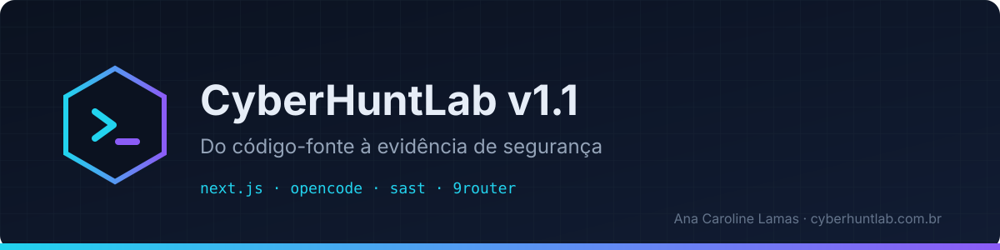

<p align="center"></p>

# CyberHuntLab v1.1 — auditoria estática de ZIP e bancada OpenCode

Plataforma web em **Next.js** que une uma bancada de desenvolvimento com IA (interface para o **OpenCode** e gateway **9Router**) a um laboratório de **auditoria estática de segurança** para projetos enviados em ZIP. A versão 1.1.0 concentra-se na segurança da própria plataforma: login obrigatório, cofre de credenciais cifrado, proteção contra SSRF e ZIP bomb e 67 testes automatizados.

## Recursos

### Auditoria estática de ZIP

- Inspeciona arquivos de texto **sem executar** o conteúdo e aponta:
  - segredos expostos, TLS desativado, execução dinâmica, CORS permissivo e modo debug;
  - configurações de Docker, Kubernetes, Terraform e Vercel;
  - dependências declaradas.
- Cada achado traz `ruleId`, severidade, **confiança**, arquivo, linha, **SHA-256** do arquivo, CWE (quando bem fundamentado) e histórico de decisões.
- Fluxo de triagem: `DETECTED → ANALYZING → EVIDENCE_FOUND → VALIDATED | UNCONFIRMED | FALSE_POSITIVE`. O analisador só cria `DETECTED`; as demais transições são decisões do pesquisador.
- Exporta o relatório em JSON, com o hash do arquivo ZIP, ou o envia ao modelo do chat para uma triagem assistida.

### Bancada de desenvolvimento

- Chat com modelos via servidor OpenCode, 9Router (fallback e rotação de provedores) ou Groq.
- Agente que cria ou atualiza projetos e devolve um ZIP para download.
- Catálogo dinâmico de provedores e modelos, publicação no GitHub e biblioteca de skills (`SKILL.md`).

### Segurança da plataforma (v1.1)

- **Login obrigatório**: sessão em cookie HttpOnly assinado (HMAC-SHA256, 12 h) e middleware em todo `/api`. Sem `APP_ACCESS_TOKEN`, a API responde 503.
- **Cofre de credenciais**: chaves de Groq, GitHub, OpenAI, Gemini e OpenCode cifradas com AES-256-GCM num cookie HttpOnly; o navegador nunca vê os valores.
- **Anti-SSRF**: servidores OpenCode personalizados só são aceitos se o host estiver em `OPENCODE_ALLOWED_HOSTS`.
- **ZIP seguro**: bytes contados na descompactação real e rejeição de symlinks, `..`, caminhos absolutos, duplicatas e cabeçalhos adulterados.
- **Rate limiting** e verificação de sessão em cada rota.

## Instalação

Requisitos: **Node.js 22+** (os testes usam `--experimental-strip-types`) e npm.

```bash
git clone https://github.com/ticarollamas-arch/cyberhuntlab-v1-1-0--2-.git
cd cyberhuntlab-v1-1-0--2-
npm install
cp .env.example .env.local
echo "APP_ACCESS_TOKEN=$(openssl rand -base64 48)" >> .env.local
```

### Variáveis de ambiente

| Variável | Uso |
|---|---|
| `APP_ACCESS_TOKEN` | **Obrigatória** (mín. 32 caracteres). Login e derivação das chaves de sessão e do cofre |
| `OPENCODE_SERVER_URL` / `OPENCODE_SERVER_PASSWORD` | Servidor OpenCode padrão |
| `OPENCODE_ALLOWED_HOSTS` | Hosts extras aceitos como servidor OpenCode privado |
| `NINEROUTER_BASE_URL` / `NINEROUTER_API_KEY` / `NINEROUTER_DEFAULT_COMBO` | Gateway 9Router |
| `GITHUB_TOKEN`, `GROQ_API_KEY`, `OPENAI_API_KEY` | Chaves de servidor opcionais, usadas só após login |
| `S3_*` | Armazenamento de artefatos (opcional) |

## Como usar

```bash
npm run dev      # http://localhost:3000 — a tela de login pede o token
npm test         # 67 testes: autenticação, cofre, SSRF, ZIP bomb, symlink, analisador e rotas
npm run build && npm start
```

1. Entre com o `APP_ACCESS_TOKEN`.
2. Em **Minhas APIs**, cadastre suas chaves; elas são validadas e guardadas no cofre.
3. Na aba **CyberHuntLab**, envie o ZIP de um projeto seu ou autorizado, revise os achados, mude o status de cada um e exporte o JSON.
4. Use a bancada para conversar com o modelo ou gerar e atualizar projetos.

Para o 9Router, veja o exemplo de proxy reverso em `deploy/nginx-9router-api.conf.example`, que publica só `/v1/*` e `/health`.

## Limitações

- No Vercel, o ZIP é limitado a 3 MB, 1.500 entradas e 24 MB descompactados.
- O analisador não executa código nem testa endpoints e não consulta CVE/OSV: uma dependência listada não é necessariamente vulnerável.
- Achados são indicadores de triagem, sujeitos a falsos positivos e validação humana. Use apenas em projetos próprios ou autorizados.
- Próximos passos sugeridos: executor isolado com Trivy, Semgrep, OSV-Scanner e Checkov.

Documentação complementar: [SECURITY.md](SECURITY.md), [SECURITY-ROADMAP.md](SECURITY-ROADMAP.md), [CHANGELOG.md](CHANGELOG.md), [UPSTREAMS.md](UPSTREAMS.md).

## Tecnologias

Next.js 15 · React · TypeScript · Node.js test runner · AES-256-GCM / HMAC-SHA256 · `@opencode-ai/sdk` · 9Router · Groq · JSZip · lucide-react · Vercel

## Créditos

- [OpenCode](https://github.com/anomalyco/opencode): motor de execução usado pelo SDK oficial `@opencode-ai/sdk`. Todos os créditos do motor pertencem aos seus mantenedores; esta aplicação é a camada de interface web.
- [9Router](https://github.com/decolua/9router): gateway compatível com a API da OpenAI.
- [opencode-dynamic-context-pruning](https://github.com/Tarquinen/opencode-dynamic-context-pruning): plugin referenciado em `opencode.json` (AGPL-3.0).

## Licença

Código deste repositório sob a licença MIT. Veja [LICENSE](LICENSE). Projetos e dependências de terceiros mantêm suas próprias licenças.
